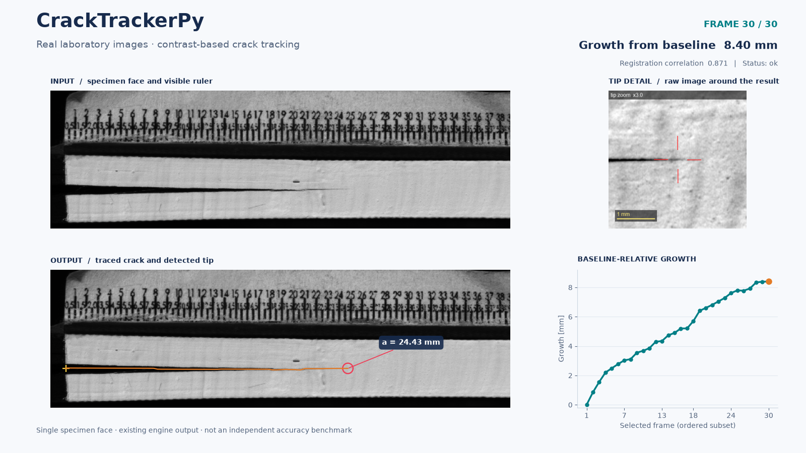
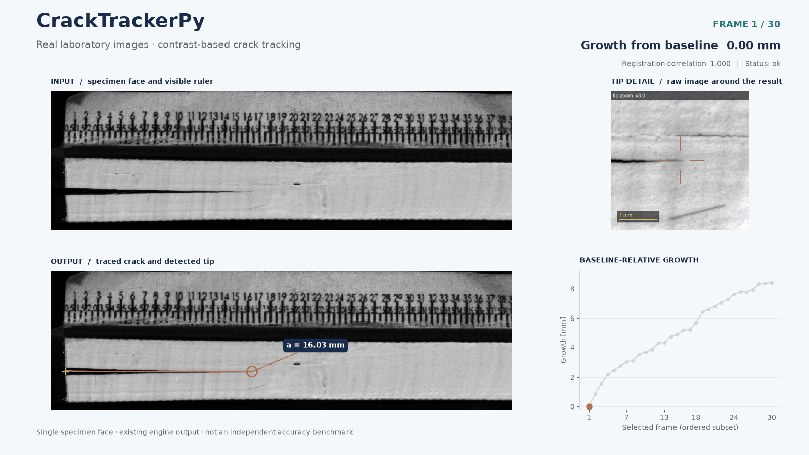

# CrackTrackerPy

**Image-based crack-growth measurement for laboratory experiments.**

CrackTrackerPy is a Python desktop application that measures visible crack tips in image sequences, converts pixel distances to millimetres, and combines measurements from two specimen faces. It supports batch processing and monitoring folders as new images arrive. The system is used in a research laboratory.

The measurement method uses image registration, local intensity contrast and connected-path tracing. It does not require a trained neural network.



## Real-image demonstration

Thirty owner-authorized images from one specimen face are included with a reproducible example. The annotations, tip detail and growth plot below are produced by the existing engine.



```sh
python examples/lab_demo.py --output demo_output/lab
```

See the [real-image example](docs/REAL_IMAGE_DEMO.md) for calibration, initialization, input preparation and interpretation. The animation presents engine outputs; the desktop interface is separate. This single-face example is not a two-face benchmark or independent experimental accuracy validation.

## What is implemented

- Per-side calibration from known distances in an image.
- Translation registration against a baseline image using normalized cross-correlation.
- Crack tracing in short segments, with local background comparison and direction updates.
- Absolute crack length `a`, baseline-relative growth `delta_a`, side A/B measurements and their mean.
- Batch and live folder processing, plots, annotated-image export and CSV export.
- Sensitivity adjustment, registration/measurement status, manual tip correction and remeasurement.
- A separate compact-tension (C(T)) interface with specimen geometry helpers, projected crack length, a temporal growth guard and load-calculation helpers.

The desktop interface is primarily **Hebrew, right-to-left**. Documentation and the headless example are in English.

## Quick start

Use **64-bit Python 3.13** with your virtual environment activated. Run the following commands from the repository root; `python` refers to the active environment's interpreter.

```sh
python -m pip install -r requirements.txt
python app.py
```

To open the C(T) interface:

```sh
python ct_app.py
```

See [installation and troubleshooting](docs/INSTALLATION.md) and the [measurement guide](docs/USAGE.md). The C(T) interface uses Windows `winsound`; other operating systems have not been verified for the desktop application.

## Measurement workflow

1. Select a folder for side A; optionally enable side B and select its folder.
2. Calibrate each side using a known distance. Mark the measurement origin and approximate baseline tip.
3. Inspect the baseline and a later image; adjust sensitivity or the registration region if needed.
4. Process the existing sequence or start live folder monitoring.
5. Review flags and tip overlays, make any justified manual corrections, then export results.

**Pairing matters:** two ordinary folders are paired by natural filename order, up to the shorter sequence; they are not synchronized by timestamps. The optional phone workflow uses a separate name-based pairing mechanism. Do not combine unrelated recordings.

When both sides have finite values, the reported length is their arithmetic mean. With only one finite value, the application uses that value; a mean field therefore does not guarantee that both sides were measured successfully. The combined growth is relative to the first finite combined length. Check per-side values and status fields when interpreting exports.

## How the measurement works

`crack_core.py` reads the image, registers it to a baseline, and traces a connected path within a narrow band. The path is scored using local intensity evidence, with direction refitted between short segments. The tip is estimated where the evidence falls below the selected threshold. Thresholds can be estimated from baseline background texture or adjusted by the user.

The general interface measures length along the traced path from the selected origin. The C(T) interface projects the tip onto the configured crack axis from the load line. Its growth guard requires new image evidence to persist in subsequent frames and can revise provisional measurements.

See [architecture and limitations](docs/ARCHITECTURE.md) for the code map and interpretation details.

## Verification

```sh
python -m unittest discover -s tests -v
```

Tests use synthetic images and do not require unpublished research datasets. Laboratory use and comparison against manual measurements are reported by the project owner. This repository does not publish an independent experimental benchmark, a general accuracy figure, or a timing guarantee. See [validation scope](docs/VALIDATION.md).

## Data, optional integrations and rights

Only the thirty explicitly authorized real-image examples are included. Other research images, measurement workbooks, local configurations, executables, Android APKs and bundled third-party tools are excluded. The phone integration source is included, but its Android companion application is not; see [optional hardware integration](docs/OPTIONAL_HARDWARE.md).

This repository contains illustrative C(T) dimension presets, not the laboratory's specimen drawing or load schedule. The load-stage list starts empty. Enter reviewed values for your own experiment.

No open-source license has been granted. See [publication review](docs/PUBLICATION_REVIEW.md) for data and rights notes.
