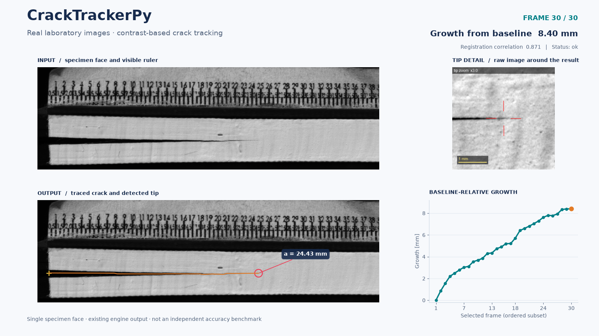
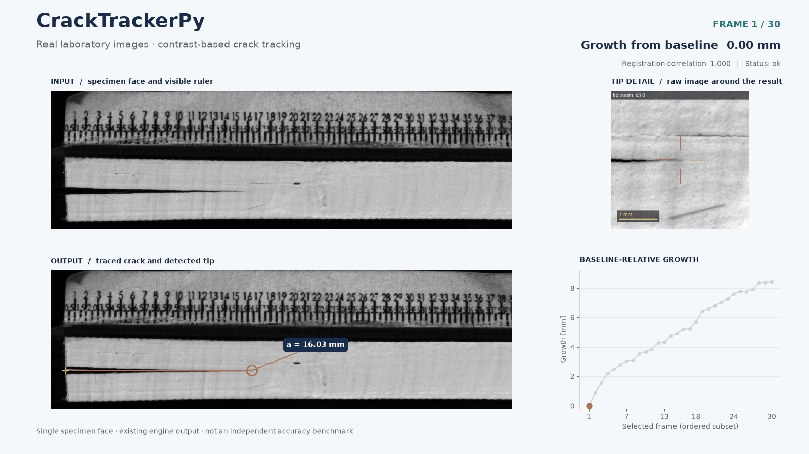

# Real-image demonstration





## Reproduce

```sh
python -m pip install -r requirements-core.txt
python examples/lab_demo.py --output demo_output/lab
```

The distributed inputs are in `examples/lab_sequence/`. This is an ordered thirty-frame subset from **one specimen face**, not a paired two-face experiment. The general desktop application supports two-face measurements separately; this demonstration does not infer a second face from unrelated recordings.

## Explicit setup

All coordinates below refer to the cropped, quarter-turned PNG inputs, with zero-based `(x, y)` pixels.

| Setting | Value |
|---|---|
| Image dimensions | 2150 x 650 px |
| Calibration endpoints | `(282, 220)` and `(1443, 220)` |
| Ruler marks | Numbered marks 1 and 31 |
| Physical calibration distance | 30 mm; 1 mm per numbered interval, confirmed by the owner |
| Resulting scale | `30 / 1161` mm/px, approximately 38.7 px/mm |
| Measurement origin | `(250, 432)` |
| Approximate baseline tip | `(880, 432)` |
| Registration ROI `(x, y, width, height)` | `(1800, 350, 180, 140)` |
| Maximum translation search | 80 px |
| Other detector parameters | `crack_core.default_params()` |

The seed is an approximate user initialization. The engine refines the tip and computes the baseline length; displayed coordinates and lengths are not manually drawn to match a desired result.

## Interpretation

The figure and GIF show actual `prepare_side()` / `measure_frame()` outputs, including per-frame registration correlation and status. Their English presentation is generated by the example script, rather than captured from the Hebrew desktop application. The pale full-series line provides context in the animation; the highlighted portion advances through the selected frames.

Lengths depend on the chosen origin, calibration, region and detector settings. The earlier CSV exports found with the source recording are not distributed or treated as independent ground truth. A different initialization can yield different absolute lengths or tip estimates. This example demonstrates the implemented workflow; it is not a general accuracy benchmark or a claim about every image in the full recording.

## Permission and preparation

The owner authorized including the example images in the project. Only the fixed lossless crop/quarter-turn subset is included, with neutral filenames and no retained metadata. See the input folder's README for the exact preparation. Other research images, measurement workbooks, local paths and original filenames remain excluded. The GitHub repository remains private unless the owner explicitly approves a visibility change.
